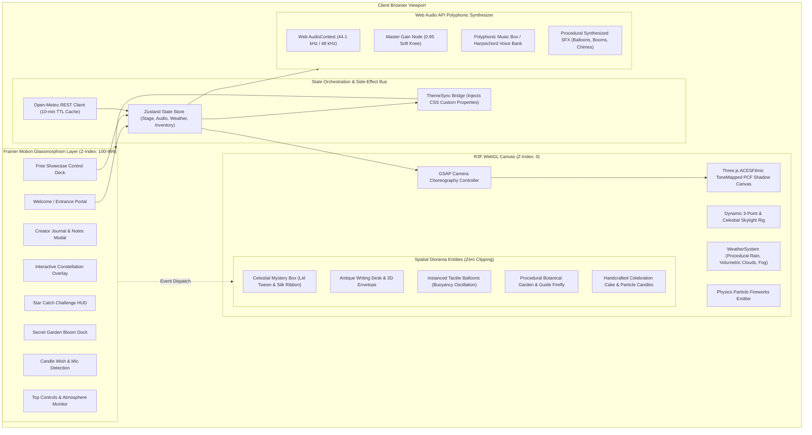
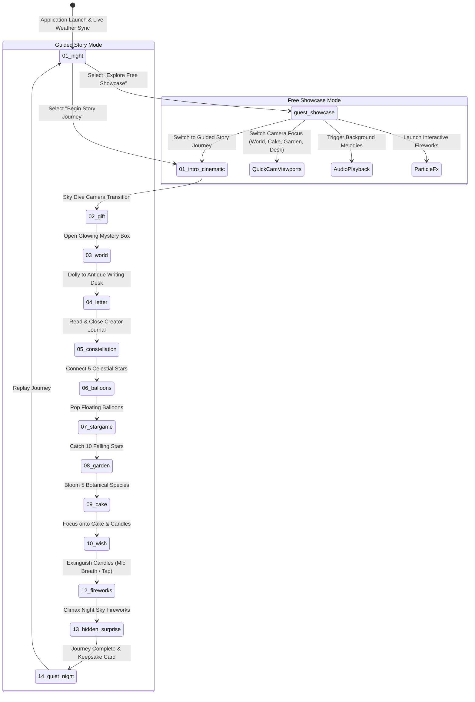

<div align="center">
  <h1>✨ Celestial Diorama — 3D WebGL Showcase</h1>
  <p>An immersive, cinematic 3D digital experience and interactive storytelling showcase built with React 19, Three.js, React Three Fiber, and TypeScript by <strong>Timon</strong>.</p>

  <p>
    <a href="#-overview">Overview</a> •
    <a href="#-architecture--system-topology">Architecture</a> •
    <a href="#-state-machine--interaction-flow">Interaction Flow</a> •
    <a href="#-core-sub-systems">Core Sub-Systems</a> •
    <a href="#-tech-stack">Tech Stack</a> •
    <a href="#-performance-engineering">Performance</a> •
    <a href="#-local-development">Development</a>
  </p>

  <p>
    
    
    
    
    
    
  </p>
</div>

---

## 📖 Overview

**Celestial Diorama** is a production-grade **3D WebGL single-page application** and digital art showcase designed and developed by **Timon**. It blends modern real-time 3D graphics, procedural shader-driven materials, physics-based particle simulation, spatial audio synthesis, dynamic live weather integration, and cinematic camera choreography into an interactive, high-performance web experience.

The project demonstrates how creative coding, storytelling, and UI engineering come together to produce a museum-grade digital diorama that maintains a buttery 60 FPS across mobile and desktop devices.

---

## 🏛️ Architecture & System Topology

The application is architected as a bidirectional reactive pipeline between the Three.js WebGL canvas and a Framer Motion glassmorphic UI layer, synchronized through Zustand:



---

## 🎬 State Machine & Interaction Flow

The visitor can explore the diorama via two distinct paradigms:
1. **Guided Story Journey:** A fully scripted, cinematic 11-stage narrative journey through the diorama zones.
2. **Free Diorama Showcase:** A sandbox mode with quick-switch camera viewpoints, particle triggers, and music playback.



---

## 🎮 Core Sub-Systems

### 1. ⛅ Dynamic Atmosphere & Real-Time Weather Engine
Connects to live meteorological REST APIs (Open-Meteo) with coordinate fallback and a 10-minute in-memory/session storage cache.
- **Atmospheric Lighting:** Automatically computes sun elevation and switches ambient and directional light between dawn, daylight, sunset, and starry night.
- **Particle Weather:** Real-time volumetric clouds, procedural rainfall particle generators, and adaptive fog density (`FogExp2`).
- **`ThemeSync` Bridge:** Translates WebGL environmental light levels directly into DOM CSS custom properties (`--bg-atmosphere`, `--glass-border`, `--text-starlight`), ensuring complete visual cohesion between 3D canvas and 2D overlays.

### 2. 🎥 GSAP-Powered Camera Choreography
Replaces default jerky camera jumps with smooth, mathematically interpolated transitions:
- Employs custom GSAP tweening logic layered over `@react-three/drei`'s `OrbitControls`.
- Seamlessly updates both position vector $(x, y, z)$ and look-at target vector $(lx, ly, lz)$ simultaneously with cubic easing (`power2.inOut`).
- Automatically adapts camera distance and vertical FOV dynamically between mobile portrait (`fov: 70`) and desktop widescreen (`fov: 45`).

### 3. 🌿 Procedural Botanical Garden & Guide Firefly
- Five distinct botanical species (Blush Camellia, Golden Marigold, Lavender Aster, Sage Blossom, Starlight Daisy) generated from procedural geometry and custom shaders.
- Raycasted interactive blooming with organic scale tweens and harmonic chime playback.
- Autonomous guide firefly programmed with a multi-frequency Lissajous curve trajectory and dynamic point-light casting real-time shadows onto mossy diorama rocks.

### 4. 🎙️ Candle Extinguish Microphone Detection
- Uses the Web Audio API's `AnalyserNode` to sample real-time microphone energy.
- Real-time frequency bin analysis detects sustained breath-energy bursts $(avg > 52)$, triggering an instant physical candle extinguish event with rising smoke puffs.
- Includes a smooth touch/click fallback for environments where microphone access is unavailable.

### 5. 🔊 Polyphonic Web Audio Engine
- Built purely on the Web Audio API without bulky audio MP3 downloads.
- Synthesizes polyphonic chime chords, warm music box melodies, physical balloon pops, and multi-layered fireworks explosions (sub-bass boom + golden crackle tails).

---

## 🛠️ Tech Stack & Dependencies

| Category | Technology | Purpose |
| :--- | :--- | :--- |
| **Framework** | [React 19](https://react.dev/) | Component architecture and state lifecycle |
| **Language** | [TypeScript 6](https://www.typescriptlang.org/) | Strict type-safety across all entities and state |
| **Bundler** | [Vite 8](https://vitejs.dev/) | Lightning-fast HMR and optimized tree-shaken builds |
| **3D Engine** | [Three.js](https://threejs.org/) (r185) | Scene graph, PBR shaders, lighting, tone mapping |
| **React 3D Bridge** | [`@react-three/fiber`](https://docs.pmnd.rs/react-three-fiber/) | Declarative component wrapper for Three.js |
| **3D Helpers** | [`@react-three/drei`](https://github.com/pmndrs/drei) | Camera controls, adaptive DPR, procedural utilities |
| **Camera Tweens** | [GSAP 3](https://greensock.com/gsap/) | High-precision camera position and target interpolation |
| **UI Motion** | [Framer Motion 13](https://www.framer.com/motion/) | Spring-based glassmorphic overlay transitions |
| **State Store** | [Zustand 5](https://github.com/pmndrs/zustand) | Centralized, zero-boilerplate application state |
| **Styling** | CSS Modules & Variables | Scoped, responsive glassmorphism styles |
| **Linter & Tools** | [Oxlint](https://oxc-project.github.io/) | High-speed static analysis and linting |

---

## ⚡ Performance Engineering

Built with a strict goal of maintaining 60 FPS on both mobile devices and desktop machines:

| Metric | Target | Implementation Strategy |
| :--- | :--- | :--- |
| **First Contentful Paint (FCP)** | `< 0.8s` | Zero heavy external 3D models (`.gltf` / `.bin`); all meshes are procedurally generated. |
| **Frame Rate** | `60 FPS` | Hardware-adaptive DPR (`1.0x` – `1.5x` on mobile; `1.0x` – `2.0x` on desktop). |
| **GPU Memory Leaks** | `0 bytes` | Strict disposal cycle (`geometry.dispose()`, `material.dispose()`, `texture.dispose()`) on unmount. |
| **Draw Calls** | Optimized | Instanced meshes for particle clouds and fireflies; bounded shadow map frustums. |
| **Tone Mapping** | Film-grade | `ACESFilmicToneMapping` with exposure balancing between day and night cycles. |

---

## 📂 Project Structure

```text
celestial-3d-showcase/
├── docs/
│   ├── architecture.md    # In-depth architectural specification & sequence diagrams
│   └── assets.md          # 3D procedural geometry specs & design tokens
├── public/
│   ├── audio/             # Fallback audio assets
│   ├── favicon.svg        # Celestial gold emblem favicon
│   └── icons.svg          # SVG sprite sheets
├── src/
│   ├── components/
│   │   ├── icons/         # Bespoke celestial SVG emblems (Zero emojis)
│   │   ├── letter/        # Interactive parchment creator note overlay
│   │   ├── ui/            # Glassmorphism UI overlays & stage cards
│   │   ├── Experience.tsx # Primary R3F Canvas & Camera Coordinator
│   │   └── ThemeSync.tsx  # Dynamic CSS Variable Bridge
│   ├── hooks/
│   │   ├── useAudio.ts    # Audio state & playback hook
│   │   └── useResponsive.ts# Mobile vs Desktop aspect ratio observer
│   ├── services/
│   │   └── weatherService.ts # Live Open-Meteo REST API integration
│   ├── store/
│   │   └── useStoryStore.ts # Central Zustand state engine
│   ├── styles/            # Global variables, glassmorphism, reset
│   ├── three/             # Procedural 3D Scene Components
│   │   ├── Balloons.tsx   # Interactive floating tactile balloons
│   │   ├── Cake.tsx       # Handcrafted celebration cake & candles
│   │   ├── Chocolates.tsx # Artisan diorama props
│   │   ├── Envelope.tsx   # 3D sealed stationery on writing desk
│   │   ├── Environment.tsx# Skybox, terrain plinth, and light rigs
│   │   ├── Fireworks.tsx  # Physics particle fireworks engine
│   │   ├── Flowers.tsx    # Secret garden botanical flora
│   │   ├── CelestialBox.tsx # Mystery celestial box with animated ribbon
│   │   └── WeatherSystem.tsx # Procedural rain and clouds
│   ├── utils/
│   │   ├── confetti.ts    # GPU-friendly confetti generator
│   │   ├── constants.ts   # Story text, palettes, flower data
│   │   ├── music.ts       # Polyphonic Web Audio synthesizer
│   │   └── textures.ts    # Procedural canvas textures
│   ├── App.tsx            # Root component
│   └── main.tsx           # React DOM mount point
├── package.json           # Project metadata & scripts
├── tsconfig.json          # TypeScript compiler configuration
└── vite.config.ts         # Vite build configuration
```

---

## 🚀 Local Development

### Prerequisites
- [Node.js](https://nodejs.org/) (v18+)
- npm or yarn

### Quick Setup

```bash
# 1. Clone repository
git clone https://github.com/Ti838/Birthday.git
cd tithi-gift-react

# 2. Install dependencies
npm install

# 3. Start development server
npm run dev
```

Visit [http://localhost:5173](http://localhost:5173) in your browser.

### Production Build

```bash
# Validate types and generate optimized static distribution
npm run build

# Preview production build locally
npm run preview
```

---

## 📝 Author & License

Designed, architected, and developed with passion by **Timon**.  
Released under the **MIT License**.
