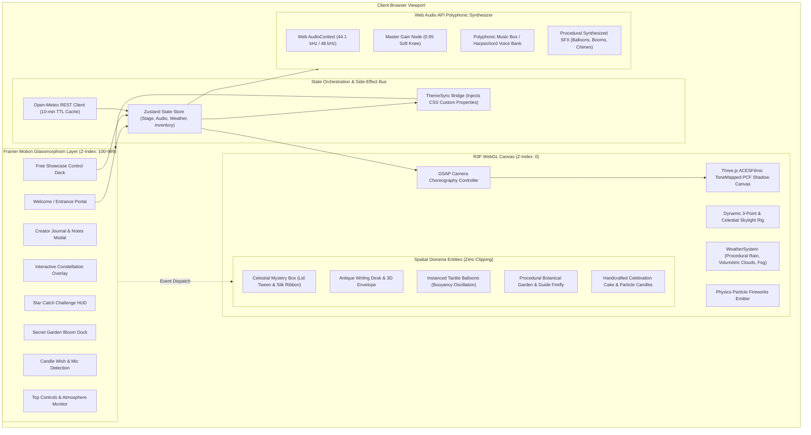
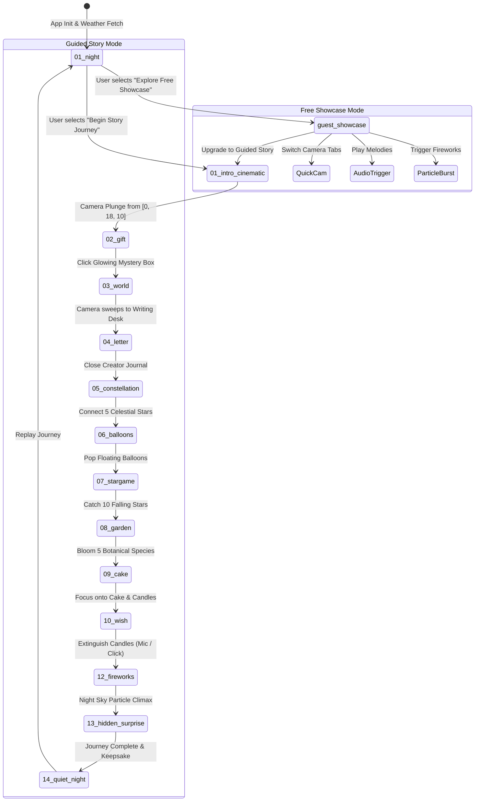
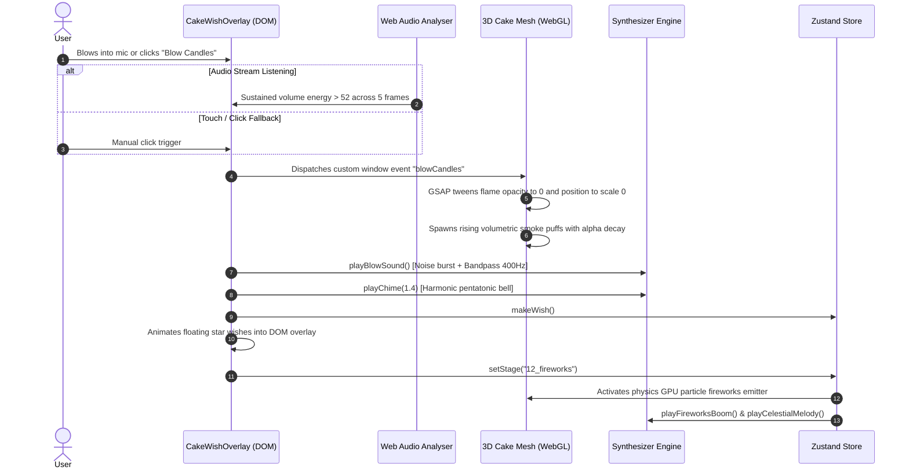

# System Architecture & Technical Specifications

> **Project:** Celestial Diorama — 3D WebGL Interactive Showcase  
> **Author:** Timon  
> **Stack:** React 19, Three.js (r185), `@react-three/fiber` (v9), `@react-three/drei` (v10), Zustand (v5), GSAP (v3), Framer Motion (v13), TypeScript 6, Vite 8

---

## 1. High-Level Architectural Topology

The application is structured as a reactive, bidirectional bridge between a **Three.js WebGL Render Pipeline** and a **Framer Motion Glassmorphism DOM UI Layer**, unified under a centralized **Zustand State Engine**.



---

## 2. Spatial Coordinate System & Zone Mapping

To avoid mesh collision, draw-order clipping, and camera occlusion, all 3D diorama entities are arranged along distinct polar and cartesian vectors on an elliptical diorama plinth:

| Zone | Entity | Position Vector $(x, y, z)$ | Camera Target $(lx, ly, lz)$ | Framing FOV |
| :--- | :--- | :--- | :--- | :--- |
| **Zone 0 (Origin)** | Diorama Base & Ambient Ground | `[0.0, 0.0, 0.0]` | `[0.0, 0.85, 0.0]` | 45° (Desktop) / 70° (Mobile) |
| **Zone 1 (Center-Front)** | Mystery Gift Box | `[-2.4, 0.2, 1.2]` | `[-2.4, 0.2, 1.2]` | 45° |
| **Zone 2 (Center)** | Antique Writing Desk & Letter | `[0.0, 0.42, 1.4]` | `[0.0, 0.42, 1.4]` | 42° |
| **Zone 3 (Right Wing)** | Five Tactile Floating Balloons | `[2.5, 0.8, -0.5]` | `[2.2, 1.55, 0.8]` | 48° |
| **Zone 4 (Left Wing)** | Secret Botanical Garden Mound | `[-2.2, 0.4, -1.4]` | `[-1.2, 0.4, -1.0]` | 45° |
| **Zone 5 (Center-Rear)**| Celebration Cake & Candles | `[0.0, 0.95, -0.4]` | `[0.0, 0.95, -0.4]` | 40° |
| **Zone 6 (Celestial)** | Fireworks & Sky Constellations | `[0.0, 2.8, -2.5]` | `[0.0, 2.8, -2.5]` | 55° |

---

## 3. Cinematic Stage State Machine

The guided experience follows an 11-stage finite state machine managed by Zustand:



---

## 4. Audio-Visual Interaction Pipeline

Here is the exact runtime sequence of an interactive event, demonstrating the coordination between DOM event listeners, the Web Audio synthesis engine, and Three.js shader materials:



---

## 5. WebGL Performance & Memory Management Standards

To guarantee 60 FPS across mobile (iOS WebKit, Android Blink) and desktop machines:

1. **Explicit Memory Disposal:**
   All dynamically allocated `THREE.BufferGeometry`, `THREE.Material`, and canvas-generated `THREE.CanvasTexture` instances register cleanup handlers during React unmount cycles:
   ```ts
   useEffect(() => {
     return () => {
       geometry.dispose();
       if (Array.isArray(material)) {
         material.forEach((m) => m.dispose());
       } else {
         material.dispose();
       }
       texture.dispose();
     };
   }, [geometry, material, texture]);
   ```

2. **Zero Large External Assets:**
   Instead of downloading megabytes of static `.gltf` or `.bin` meshes, 100% of geometries (flowers, cake tiers, table surfaces, lanterns, balloons) are procedurally constructed using primitive compositions (`CylinderGeometry`, `SphereGeometry`, `ExtrudeGeometry`) and procedurally drawn HTML Canvas textures.

3. **DPR & Tone Mapping Configuration:**
   - **DPR Scaling:** Capped at `[1, 1.5]` for mobile viewports, `[1, 2]` for desktop screens to prevent thermal throttling on high-density Retina displays.
   - **Tone Mapping:** `THREE.ACESFilmicToneMapping` with exposure tuned dynamically between `0.85` (night) and `1.15` (day) based on ambient solar elevation.

