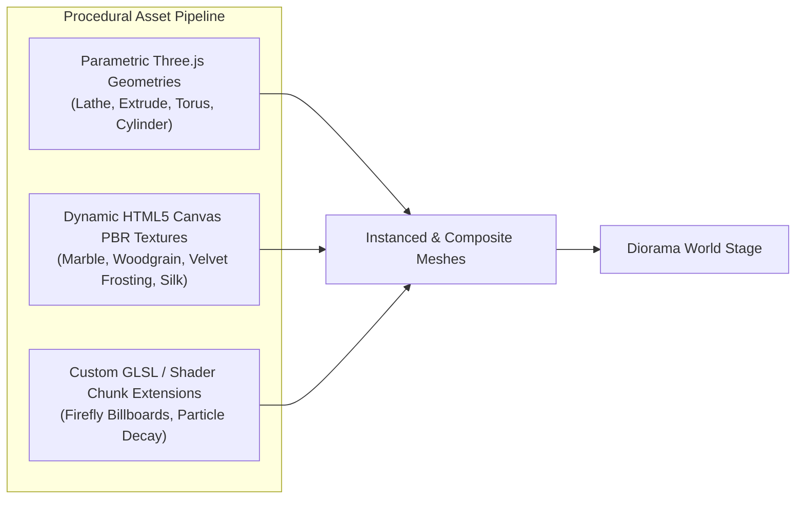
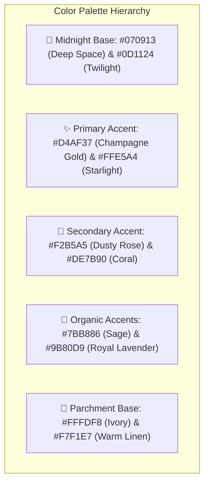
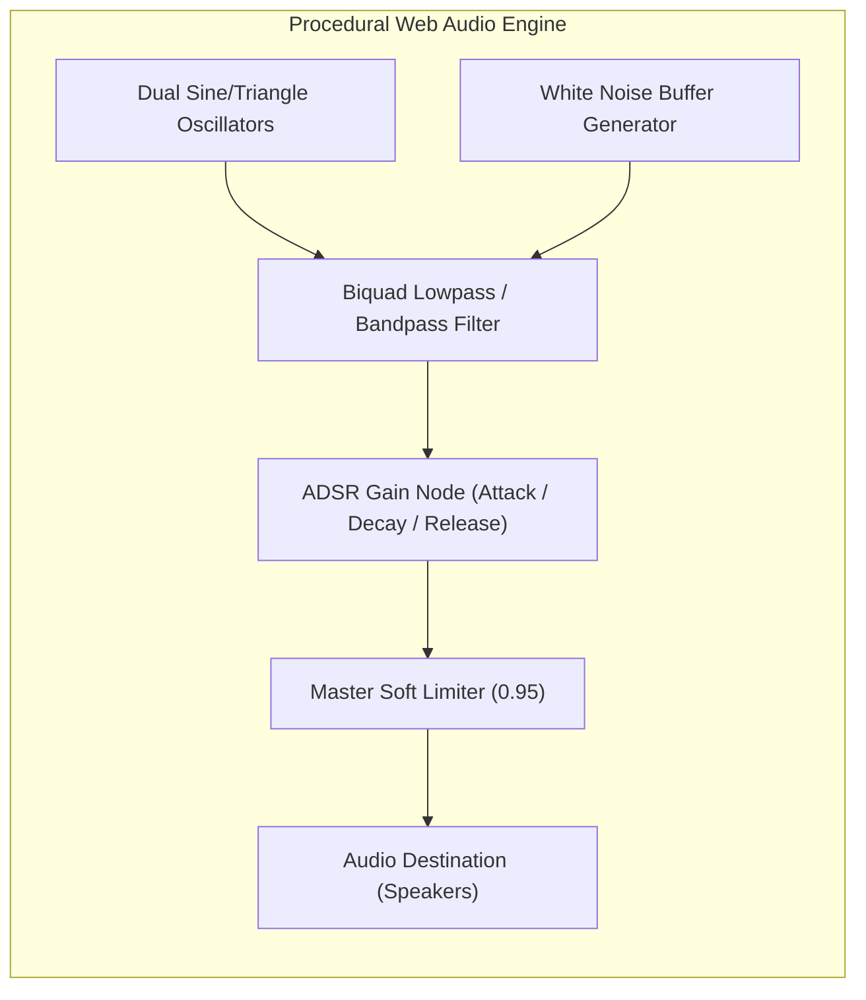

# Asset & Design Tokens Specification

> **Project:** Celestial Diorama — 3D WebGL Showcase  
> **Author:** Timon  
> **Document Status:** Production Standards (v1.0.0)

---

## 1. 3D Procedural Assets & Geometry Standards

All 3D assets in this project are authored programmatically to eliminate network latency, maintain zero external asset dependencies, and allow real-time parameter tweaking.

### 1.1 Geometry Specifications

| Asset / Element | Generation Method | Polygon Budget | Material Setup | Location in Code |
| :--- | :--- | :--- | :--- | :--- |
| **Artisan Tiered Cake** | Stacked `CylinderGeometry` + `TorusGeometry` piping | ~4,200 polys | Velvet Frosting Canvas PBR + Champagne Gold Leaf trim (`roughness: 0.18`, `metalness: 0.85`) | `src/three/Cake.tsx` |
| **Procedural Botanical Flora** | Algorithmic Petal Fans (`ExtrudeGeometry` + Curve Deform) | ~1,800 polys / flower | Subsurface scattering simulation via double-sided layered meshes with opacity gradient | `src/three/Flowers.tsx` |
| **Tactile Floating Balloons** | Deformed `SphereGeometry` with tied knot cone | ~960 polys / balloon | Satin sheen material with Fresnel edge rim lighting (`roughness: 0.22`, `metalness: 0.1`) | `src/three/Balloons.tsx` |
| **Celestial Mystery Box** | Chamfered `BoxGeometry` + Cross Ribbon Splines | ~2,100 polys | Ivory pearlescent coat with satin gold bow and physical drop shadow plinth | `src/three/CelestialBox.tsx` |
| **Writing Desk & Envelope** | Beveled planar meshes with paper fold lines | ~840 polys | Rich Mahogany Canvas Woodgrain + Parchment Paper texture | `src/three/Envelope.tsx` |
| **Autonomous Guide Firefly** | Billboarded sprite with oscillating sine path | 1 Quad (2 polys) | Additive blending starlight sprite with dynamic point light (`decay: 2.0`, `distance: 3.5`) | `src/three/Flowers.tsx` |
| **Physics Particle Fireworks** | Instanced point cloud / GPU buffer geometry | 1,500 particles / burst | Particle attributes: Position, Velocity, Color, Life, Drag, Gravity | `src/three/Fireworks.tsx` |

---

## 2. Design Tokens & Color Palette

The visual identity uses a refined palette combining celestial midnight hues, champagne golds, and botanical accents.

### 2.1 CSS Custom Properties (ThemeSync Matrix)

These variables are dynamically injected into `:root` at runtime by `ThemeSync.tsx`, keeping 2D HTML glassmorphism in synchronization with Three.js sun altitude:

| CSS Variable | Day Value | Night Value | Intended Usage |
| :--- | :--- | :--- | :--- |
| `--bg-atmosphere` | `rgba(13, 17, 36, 0.78)` | `rgba(7, 9, 19, 0.88)` | Modal backdrops & card panels |
| `--glass-border` | `rgba(212, 175, 55, 0.35)` | `rgba(143, 165, 216, 0.22)`| Card borders & structural separators |
| `--text-primary` | `#1B1E32` (on cards) / `#FFFFFF` | `#FBF9F5` | Headings & primary UI typography |
| `--text-starlight` | `#E8C872` | `#FFE5A4` | Golden badges, star icons, highlighted text |
| `--ambient-glow` | `rgba(255, 229, 164, 0.12)` | `rgba(139, 165, 216, 0.08)`| Soft radial drop shadows |

---

## 3. Typography Hierarchy

| Style Token | Font Family | Weight | Fallbacks | Usage |
| :--- | :--- | :--- | :--- | :--- |
| **Editorial Display** | `"Bodoni Moda"`, `"Playfair Display"` | 400 / 600 | Georgia, serif | Hero titles, stage banners, monogram seals |
| **Handwritten Script** | `"Dancing Script"`, `"Alex Brush"` | 500 / 700 | cursive | Signature blocks, poetic quotes, flourishes |
| **Parchment Serif** | `"Cormorant Garamond"` | 400 / 500 | Times New Roman, serif | Journal body text, letter lines, flower advice |
| **Modern Functional UI** | `"Manrope"` | 400 / 600 / 700 | system-ui, sans-serif | HUD buttons, countdown digits, tooltips, tags |

---

## 4. Web Audio Synthesizer Frequency Map

Procedurally synthesized through Web Audio API nodes (`OscillatorNode`, `BiquadFilterNode`, `GainNode`):

| Sound Event | Fundamental Frequency | Envelope (Attack / Decay) | Filter Setup |
| :--- | :--- | :--- | :--- |
| **Chime (Pentatonic)** | 523 Hz – 1,046 Hz ($C_5 - C_6$) | $A = 0.01s, D = 1.2s$ | Lowpass 2,400 Hz (Warm harmonic chime) |
| **Star Catch Ding** | $440 \times 1.2^{\text{idx}}$ Hz | $A = 0.005s, D = 0.45s$ | Highpass 600 Hz (Crystalline sparkle) |
| **Balloon Pop** | 120 Hz Noise Burst | $A = 0.002s, D = 0.12s$ | Bandpass 350 Hz (Punchy physical pop) |
| **Candle Extinguish** | White Noise Whoosh | $A = 0.05s, D = 0.65s$ | Lowpass 800 Hz (Soft breath envelope) |
| **Fireworks Boom** | 45 Hz – 90 Hz Sub Kick | $A = 0.01s, D = 1.8s$ | Sub-bass boost + High-shelf crackle tail |
